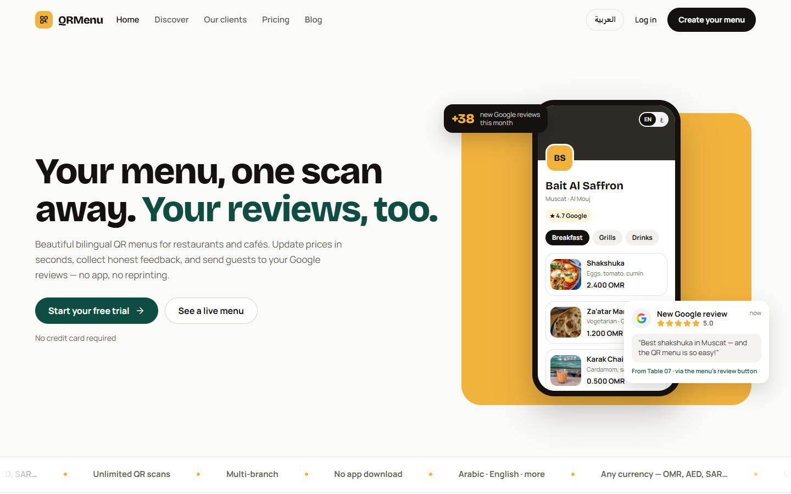
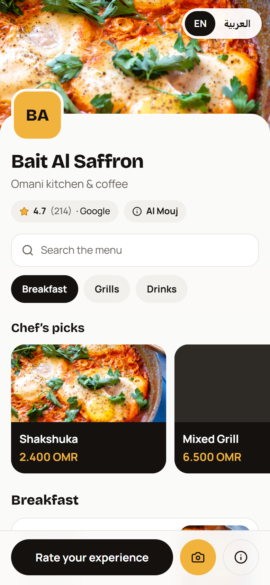
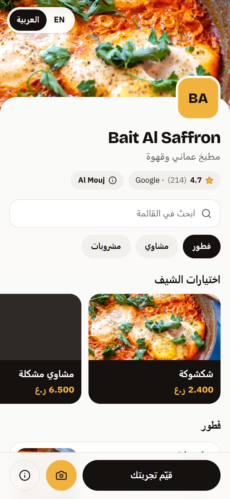
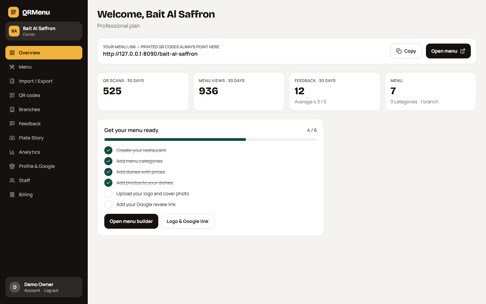
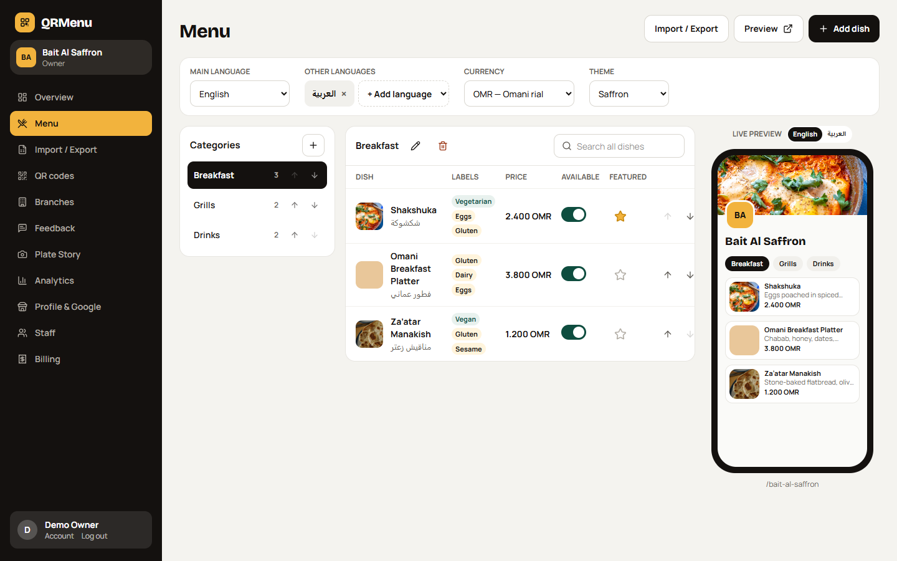
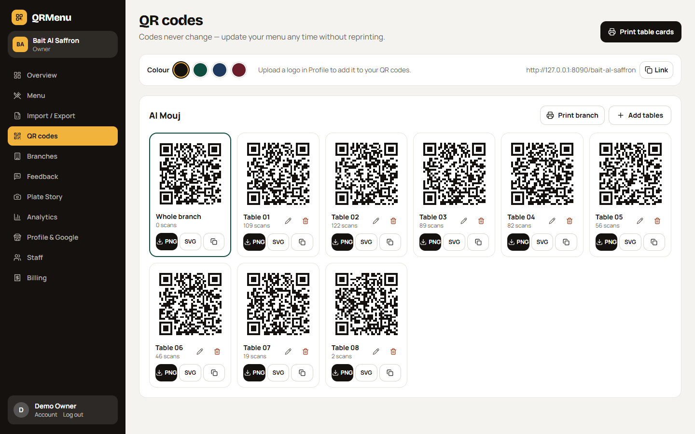
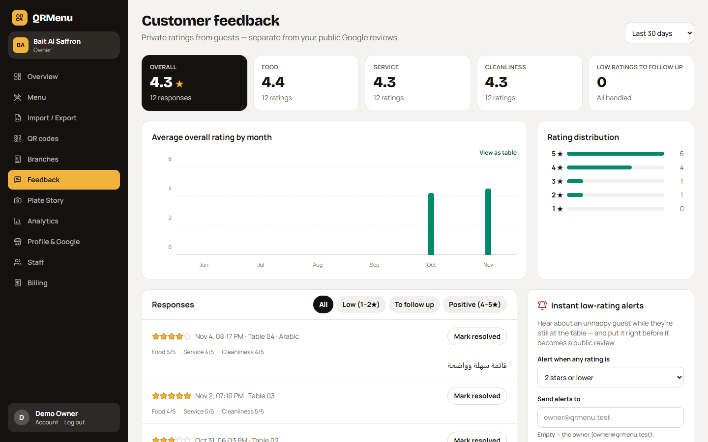
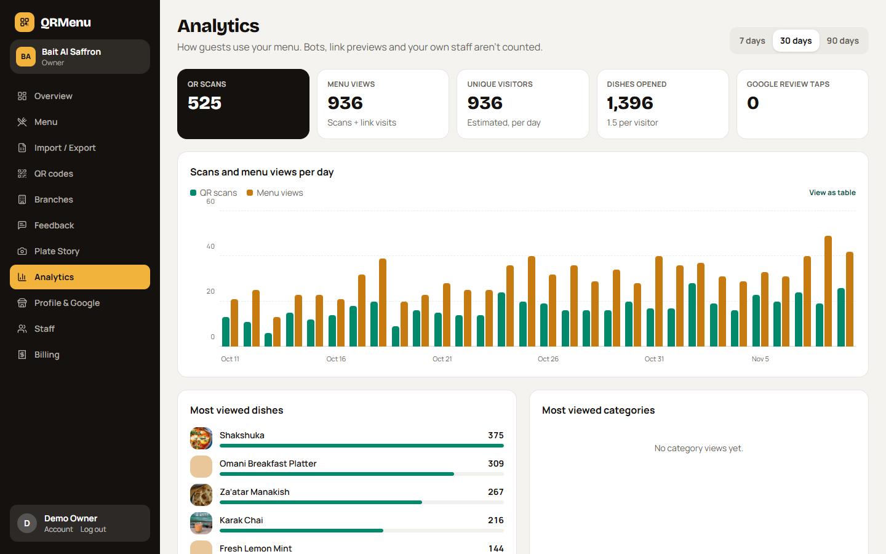
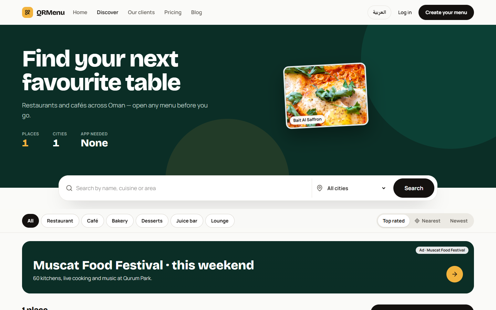
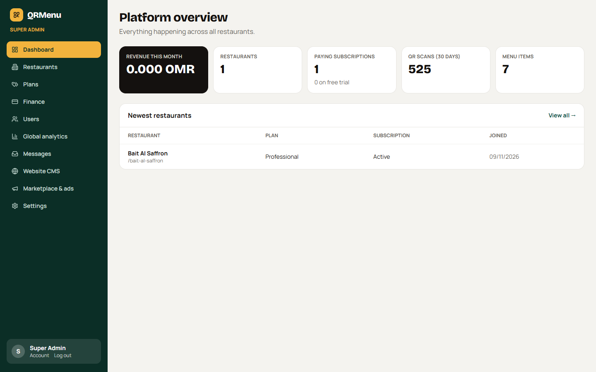

<div align="center">

# QRMenu

**Bilingual QR menus, guest feedback and Google reviews for restaurants and cafés.**

One QR code per table. Guests scan, browse the menu in English or Arabic, rate their visit, and share their plate.
Owners update prices in seconds, without reprinting anything.


<br>



</div>

---

## Contents

- [Screenshots](#screenshots)
- [Features](#features)
- [Tech stack](#tech-stack)
- [Getting started](#getting-started)
- [Testing](#testing)
- [Architecture](#architecture)
- [Subscriptions and billing](#subscriptions-and-billing)
- [Marketplace and ads](#marketplace-and-ads)
- [Low-rating alerts](#low-rating-alerts)
- [Plate Story](#plate-story)
- [Deployment](#deployment)
- [Roadmap](#roadmap)

## Screenshots

### Guest menu: English and Arabic

Guests scan a table's QR code and get a fast, mobile-first menu. Arabic switches the whole page to right-to-left.

<table>
  <tr>
    <td width="50%"></td>
    <td width="50%"></td>
  </tr>
</table>

### Restaurant dashboard

<table>
  <tr>
    <td width="50%"><br><sub><b>Overview</b>: scans, menu views, feedback and a setup checklist</sub></td>
    <td width="50%"><br><sub><b>Menu builder</b>: categories, dishes, labels, prices and a live preview</sub></td>
  </tr>
  <tr>
    <td width="50%"><br><sub><b>QR codes</b>: one per branch and per table, PNG or SVG, with scan counts</sub></td>
    <td width="50%"><br><sub><b>Feedback</b>: private guest ratings and instant low-rating alerts</sub></td>
  </tr>
  <tr>
    <td width="50%"><br><sub><b>Analytics</b>: daily scans and views, top dishes, busiest hours</sub></td>
    <td width="50%"><br><sub><b>Discover</b>: public directory with search, filters and paid placements</sub></td>
  </tr>
</table>

### Super admin



> Screenshots come from the seeded demo restaurant, *Bait Al Saffron*, with sample guest activity. Dish photos are from [Unsplash](https://unsplash.com/license).

## Features

| For guests | For restaurants | For the platform |
| --- | --- | --- |
| Menu in English and Arabic (RTL), with search and dish details | Menu builder: categories, dishes, sizes and extras, photos, dietary labels and allergens | Plans with limits (branches, languages, dishes, features) |
| Sold-out badges, chef's picks, old prices crossed out | Live phone preview, themes and any currency (3-decimal OMR/KWD/BHD) | Restaurants, users and roles |
| Private feedback straight to the manager | Branch and table QR codes (PNG/SVG, logo, printable table cards) | Finance: invoices, payments, MRR and Excel export |
| One tap to leave a Google review | CSV/Excel import with column matching, preview and error report; full export | Global analytics and storage use |
| Plate Story: share a branded photo card to Instagram/WhatsApp | Feedback dashboard with instant low-rating email alerts | Website CMS and blog (EN/AR) |
| Discover page to find places nearby | Analytics, Plate Story moderation and rewards, staff roles, billing | Marketplace ads: banners, sponsored listings, offer badges |

## Tech stack

| Layer | Technology |
| --- | --- |
| Backend | Laravel 13, PHP 8.3+, Fortify (login, 2FA, passkeys) |
| Frontend | React 19, TypeScript, Inertia 3, Tailwind CSS 4, Vite |
| Database | MySQL 8 (JSON columns for translations, `decimal(10,3)` prices) |
| Website | GSAP and Lenis animations |
| Tests | PHPUnit feature tests covering tenancy, permissions, billing, import/export and more |

## Getting started

### Requirements

- PHP 8.3+, Composer, Node.js 20+ and MySQL 8
- On Windows, [Laragon](https://laragon.org) provides all of these

### Setup (Laragon on Windows)

1. Start Laragon (Apache or Nginx, plus MySQL) and create a database named `qrmenu` (utf8mb4) in HeidiSQL or Laragon › Database.
2. Open Laragon's terminal in this folder and run:

   ```bash
   composer install
   copy .env.example .env
   php artisan key:generate
   php artisan migrate --seed
   php artisan storage:link
   npm install
   npm run dev
   ```

3. Open **http://qrmenu.test**. Laragon creates the host automatically; restart Laragon if it doesn't resolve.

On macOS or Linux, use `cp` instead of `copy` and serve the app with `php artisan serve` or your own web server.

### Demo logins

The seeder creates these accounts:

| Role | Email | Password |
| --- | --- | --- |
| Super admin | `admin@qrmenu.test` | `password` |
| Demo restaurant owner (Bait Al Saffron) | `owner@qrmenu.test` | `password` |

> [!WARNING]
> Change both passwords (Settings › Password) before deploying anywhere public.

## Testing

```bash
php artisan test        # PHP feature tests
npm run types:check     # TypeScript
```

Tests use an in-memory database and fake storage, so they never touch your real data or uploaded files.

## Architecture

| Area | URL | Who |
| --- | --- | --- |
| Super admin | `/admin` | users with `is_super_admin = 1` |
| Restaurant dashboard | `/app` | restaurant owners, managers and editors |
| Onboarding | `/onboarding` | newly registered users with no restaurant yet |
| Guest menu | `/{restaurant-slug}` | guests, no login |
| Public website | `/`, `/marketplace`, `/clients`, `/blog` | everyone (edited in Admin › Website CMS) |

**Tenant isolation.** Every restaurant-owned model uses `App\Models\Concerns\BelongsToRestaurant`. Inside `/app`,
the `restaurant` middleware sets the current restaurant. All queries are then automatically limited to it, and new
records are stamped with its id. Super-admin code is not scoped.

**Roles** live on the `restaurant_user` pivot (`owner`, `manager`, `editor`). See `App\Enums\RestaurantRole` and the
abilities registered in `AppServiceProvider` (for example `Gate::authorize('manage-menu')`).

| Role | Can do |
| --- | --- |
| Owner | Everything, including billing, branches and staff |
| Manager | Menu, QR codes, feedback, Plate Story and analytics |
| Editor | Categories and dishes only |

**Translations** are JSON columns (`{"en": "...", "ar": "..."}`) via `HasTranslations`. Prices are `decimal(10,3)`,
so the three decimals of OMR, KWD and BHD are exact.

**Security.** All forms are protected against CSRF. Uploads are checked by their file contents (SVG is refused).
Logins and public endpoints are rate-limited. Security headers (and HSTS over HTTPS) are set by `SecurityHeaders`.
CSV exports guard against spreadsheet formula injection.

## Subscriptions and billing

- **Staff** (`/app/staff`, owners only): invite people by email as Owner, Manager or Editor. New people get a
  "set your password" email, and they show as *Invited* until they set one. People who already have an account just
  sign in. Without the *Staff roles* plan feature, a restaurant can have 2 team members (owner + 1). The last owner
  can't be removed or demoted.
- **Billing** (`/app/billing`): current plan, renewal date, usage against plan limits, printable invoices, and a
  "change plan" request. Requests are emailed to the support email (Admin › Settings) and listed at the top of
  **Admin › Finance**. There, the super admin records the payment (which extends the subscription) and marks the
  request handled.

### When a plan ends

| Step | What happens |
| --- | --- |
| 7, 3 and 1 days before | Owner is emailed and a notice shows in the dashboard |
| Trial end date | Menu goes offline at once (no grace period for trials) |
| Paid plan end date | "Payment due": the menu stays online for a 7-day grace period |
| After the grace period | Menu offline ("menu unavailable" for guests) and hidden from Discover and Our clients. The dashboard is **read-only**: pages open, menu export and Billing work, nothing else can be changed |
| 14 days offline | "Your menu is still here" win-back email |
| 60 and 85 days offline | Deletion warnings to the owner |
| 90 days offline | Restaurant permanently deleted, at least 5 days after the last warning. Invoices stay in Finance and user accounts are kept |

Renewing at any point (Admin › Finance › record payment with "extend subscription") brings everything back instantly
and stops the clock. Win-back emails and automatic deletion can be switched off in **Admin › Settings › Billing emails**.

## Marketplace and ads

The public **Discover** page (`/marketplace`) lists restaurants that opted in (Profile › Marketplace) and whose menu
is live. Guests search by name, cuisine or area, filter by city and type, and sort by:

- **Top rated**: from guest feedback on the platform (at least 3 ratings; otherwise shown as "New");
- **Nearest**: the guest's location compared with each branch's latitude and longitude (set in Branches);
- **Newest**.

Paid placements are managed in **Admin › Marketplace & ads**:

- a top **banner**;
- **sponsored** listings, pinned first (at most 3);
- **sidebar** ads;
- **offer** badges on a listing.

Each has dates, optional city targeting and a price. Creating a campaign can also create its advertising invoice in
Finance, due 7 days after it's issued (or on the start date, if that's later). Impressions count once per visitor per
day, and clicks go through `/ads/{id}/click`. Bots are ignored. Visits from Discover show as source "Marketplace" in
each restaurant's analytics.

## Low-rating alerts

Restaurants choose a threshold and an alert email under **Feedback › Instant low-rating alerts**. If the email is left
empty, alerts go to the restaurant's owners. Emails are sent once mail is configured in `.env` (`MAIL_MAILER=smtp`,
`MAIL_HOST`, …). Locally, the default `MAIL_MAILER=log` only writes them to `storage/logs/laravel.log`.

Alerts are sent right after the guest's request finishes, so no queue worker is needed.

## Plate Story

Guests tap the camera button on the menu, photograph their dish (and optionally the empty plate), pick a card design,
and share a 1080×1920 story image through the phone's share sheet (Instagram Story, WhatsApp, …). Photos appear on the
dish in the menu only after the restaurant approves them and links them to a dish.

**Rewards** are optional and only for sharing, never tied to reviews or ratings. They are limited per guest device
(once per day, week or month) and by a daily cap per restaurant. Before staff use a code, they see the guest's photo
and confirm it. Codes from hidden photos can't be redeemed.

**Storage.** The story card is made and shared on the guest's phone and is never uploaded. Photos are uploaded as
1080px WebP (about 100–150 KB) and re-encoded on the server, which also strips hidden data such as GPS location. Every
night, `plate-stories:cleanup` deletes the following photos:

- photos hidden for 7+ days;
- photos never approved within 30 days;
- approved photos beyond the newest 12 per dish.

The story records stay for statistics. The command then measures disk use per restaurant (Admin › Global analytics).
Preview what it would delete with `php artisan plate-stories:cleanup --dry-run`.

## Deployment

See **[DEPLOY.md](DEPLOY.md)** for the Hostinger VPS + CloudPanel guide: HTTPS, production `.env`, scheduler cron,
backups and a launch checklist. The scheduler runs `subscriptions:sync` daily: trials end, unpaid renewals get a 7-day
grace period, and then the guest menu goes offline until the super admin records a payment in Finance.

Before going live:

- set `APP_DEBUG=false` and `SESSION_SECURE_COOKIE=true`;
- set a platform address as **Admin › Settings › Support email** (it appears on invoices and on the contact page);
- change the seeded passwords.

## Roadmap

1. ✅ **Foundation**: schema, tenancy, roles, onboarding, super-admin plans, restaurants and brand settings
2. ✅ **Restaurant and menu management**: profile and Google link, branches, menu builder (categories, dishes, sizes/extras, photos, labels, languages, currency, theme, live preview)
3. ✅ **CSV/Excel import and export**: template, column matching (EN/AR headers), preview, add / update / add-and-update, error report, history, export (including sizes and extras)
4. ✅ **QR codes and guest menu**: branch and table codes (PNG/SVG, logo, print cards); EN/AR menu with RTL, themes, search, dish details, feedback, Google review and scan analytics
5. ✅ **Engagement**: feedback dashboard and low-rating alerts, Plate Story (story cards, rewards, photo approval), analytics, super-admin finance
6. ✅ **Website**: Home, Our clients and Blog (EN/AR, GSAP + Lenis), Website CMS and blog editor, security headers, subscription expiry job, deployment guide
7. ✅ **Growth**: staff invites and roles, billing, pricing → sign-up plan pre-selection, super-admin users and global analytics, Discover marketplace with paid ads

## License

QRMenu is released under the [MIT License](https://opensource.org/licenses/MIT).
